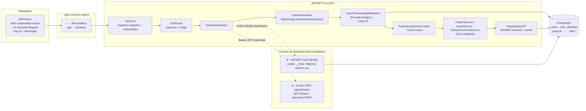

# ADR — Identidad y autenticación de MVP 3.1 (M3.1-S01 … M3.1-S10)

Estado: **CONFIRMADA por la persona dueña del producto el 2026-10-15** (opción A: ASP.NET Core Identity + cookie). Decisiones confirmadas, ver «Decisión confirmada» más abajo.
Las preguntas abiertas que no figuran allí siguen pendientes y se resuelven en la tarjeta que las necesita (S02/S05/S07/S08/S09).
Este ADR **recomienda** y demuestra con un PoC; **no** decide por la persona dueña ni contrata nada. S02–S10 implementan la opción confirmada, sin mezclar estrategias. Orden fijado: **migración a .NET 10 primero**, luego S02.
Dónde está el código del PoC: `backend/spikes/AuthPoc/` (README con cómo correrlo). El producto **no cambió** en esta tarjeta.

## Resumen para la persona dueña del producto (una página)

**Qué hay que resolver.** Hoy todos los usuarios son «el usuario de desarrollo» (`DevelopmentUserContext`) y la API **se niega a arrancar**
fuera de Development/Testing. Antes de construir registro y login hay que elegir **quién autentica a las personas**.

**Qué recomiendo (opción A).** **ASP.NET Core Identity con sesión en cookie**, dentro de la propia API y con los datos en el Postgres que ya
tenéis. Sin proveedor externo, sin licencia, sin tokens guardados en el navegador. El dominio (`Project`, servicios, repositorios) **no
cambia**: solo se registra un `AuthenticatedUserContext` en lugar del de desarrollo (el PoC lo demuestra con dos fuentes de identidad
distintas). Si más adelante hace falta un proveedor gestionado, se añade como segunda fuente sin tocar el dominio.

**Por qué (hechos, no gustos).**
1. El frontend pide imágenes y descargas con URL directas (``, previews, miniaturas, export; **[C]**). Con tokens en
   cabecera habría que reescribir todo eso; con cookie funciona tal cual.
2. Los topes gratuitos de los gestionados cubren de sobra el tráfico inicial (Auth0 25 000 MAU, Clerk 50 000 MRU, Entra 50 000 MAU; **[V]**),
   así que **el coste no decide hoy**; lo que decide es MFA, email, residencia de datos y dependencia, que **no están declarados**.
3. Las páginas oficiales consultadas **no** dan residencia UE para Clerk ni (en lo revisado) para Entra, y Auth0 solo por fuente secundaria
   (**[V]/[S]**): con Identity la residencia es vuestra decisión de hosting.
4. Sin MFA en los planes gratuitos de Auth0 ni de Clerk (**[V]**): si MFA o login social se necesitan «ya», el gestionado deja de ser gratis o cambia de plan.

**Lo que cuesta.** Licencia: 0. Pero **sois vosotros quienes operáis**: el envío de email (verificación y recuperación; coste **no verificado**),
parches de seguridad, y construir lo que Identity no trae hecho (UX de MFA, social). Más trabajo en S02/S03/S08/S09 que con un proveedor gestionado,
menos en S05 (UI) y S06. **Obligatorio y urgente, elijáis lo que elijáis:** migrar a **.NET 10 LTS antes del 2026-11-10** (fin de soporte de .NET 9; **[V]**).

**Lo que tenéis que decidir** (detalle en «Preguntas abiertas»): presupuesto mensual · MAU esperados · ¿obligación de residencia UE? · ¿se acepta depender de un tercero
para el login? · ¿quién opera el email? · ¿login social y/o MFA en los próximos meses? · dominio de despliegue · ¿qué pasa con los proyectos del usuario de desarrollo?

**Cambiaría la recomendación a «proveedor gestionado» si:** MFA o social son necesarios desde el día 1; **o** no queréis operar email/seguridad;
**o** necesitáis SSO empresarial (SAML). Candidatos a verificar con un tenant real (tarea humana): **Entra External ID** o **Auth0**.

---

## Leyenda de evidencia

Cada dato lleva su etiqueta. Los precios y planes **cambian: verificar antes de contratar**. Fecha de la investigación: 2026-10-14 (orquestador);
del PoC y del análisis del código: 2026-10-15. En esta tarjeta **no hay acceso web**: lo que no esté en `research.md` está marcado **[N]**.

| Etiqueta | Significado |
|---|---|
| **[V]** | Verificado en la **página oficial** por el orquestador el 2026-10-14 (URL citada). |
| **[S]** | Fuente **secundaria** (blog, comparativa, comunidad). **No verificado.** |
| **[C]** | Verificado leyendo/`grep` el **código o la configuración del repo** el 2026-10-15. |
| **[P]** | **Demostrado por el PoC** (`backend/spikes/AuthPoc`, tests ejecutados el 2026-10-15). Solo vale para lo que el test prueba. |
| **[A]** | **Análisis** del implementador a partir de otros datos etiquetados (razonamiento, no medición). |
| **[N]** | **No verificado**: conocimiento general del implementador o dato ausente de la investigación. Verificar antes de depender de él. |

Fuentes oficiales citadas (de `research.md`): política de soporte de .NET `https://dotnet.microsoft.com/en-us/platform/support/policy/dotnet-core` ·
Auth0 `https://auth0.com/pricing` · Clerk `https://clerk.com/pricing` · Entra External ID FAQ
`https://learn.microsoft.com/en-us/entra/external-id/customers/faq-customers` (actualizada 2026-10-06). Secundarias: aspnetzero.com «state of .NET auth in 2026»,
`learn.microsoft.com … identity-api-authorization`, documentación/comparativas de OpenIddict, Duende, Keycloak y AWS Cognito.

## Contexto (hechos del proyecto)

- `IUserContext` (M2.2) ya desacopla el dominio: `ProjectService`, `ProjectUploadService`, `AssetService`, `VectorDocumentService` y los endpoints solo dependen
  de la interfaz (`GetEffectiveUserId()`, `Email`, `IsAuthenticated`; síncrona y sin DB a propósito). **[C]**
- `UserContextRegistration` es el **único** punto de registro y hoy lanza `InvalidOperationException` fuera de `Development/Testing/Test`: no existe un contexto autenticado. **[C]**
- `Project.OwnerId` es FK a `users.Id` (Restrict). `User.ExternalIdentityId` (`string?`) existe desde M2.2-S02 pero **ninguna línea de código lo usa** (solo la entidad y migraciones). **[C]**
- Despliegue: `docker-compose.yml` con `postgres:17-alpine`, `python-engine`, `backend` (puerto 5080→8080) y `frontend` (nginx, 5173→80). El backend lee `Cors__AllowedOrigins`
  (default `http://localhost:5173,http://127.0.0.1:5173`) y su política CORS usa `WithOrigins(...).AllowAnyHeader().AllowAnyMethod()` **sin `AllowCredentials`**. `nginx.conf` solo sirve la SPA (sin proxy a `/api`). **[C]**
- El frontend centraliza `fetch` en `frontend/src/api/httpClient.ts` **sin `credentials`** (la base es `VITE_API_BASE_URL`, default `http://localhost:5080`) **[C]**; y construye **URL directas** que el navegador
  pide por su cuenta (``/descargas): `colorPaletteApi` (preview), `dimensionApi`, `exportApi`, `preprocessApi`, `projectsApi` (`…/original`), `projectsV2Api` (miniatura), `simplifyApi`. **[C]**
- Autorización de recursos hoy: de las **55** coincidencias de rutas `/api/v1/projects/{projectId…}` en `Endpoints/`, **solo 2** comprueban dueño (`ProjectEndpoints.cs`: `GET …/images/{imageId}` y
  `GET …/original`, vía `ProjectRecord.IsAccessibleBy`), y `IsAccessibleBy` devuelve **true si `OwnerId is null`** (registros legados). Las etapas de preprocess, threshold, vectorize, simplify, check, dimensions,
  paleta, capas, componentes, unión, operaciones, layout y export **no** consultan `IUserContext`. `/api/v2/projects*` y `…/assets` sí filtran por `OwnerId` y devuelven 404 al ajeno. **[C]**
- No hay cuentas ni claves de ningún proveedor externo. Producto B2C/prosumer; sin requisito declarado de SSO. Un solo equipo.
- Pruebas: 3 260 tests de frontend, suite .NET y E2E HTTP en `tests/e2e/*.mjs` que llaman a la API **sin credenciales** (impacto en S06/S10). **[C]** (cifras de `docs/MVP3_RELEASE.md`).

## Requisitos

**Funcionales.** RF1 registro con email+contraseña · RF2 login y logout · RF3 sesión que sobrevive a recargar y caduca · RF4 cada `User` ve **solo** lo suyo (ownership, 404 al ajeno) ·
RF5 recuperar contraseña y verificar email · RF6 perfil mínimo (nombre, email) · RF7 *(candidato)* login social y MFA · RF8 el flujo anónimo actual desaparece (todo `/api/*` exige sesión salvo salud y auth).

**Seguridad.** RS1 ningún secreto en repo ni en el navegador · RS2 contraseñas con hash adaptativo, nunca recuperables · RS3 sesión no legible por JavaScript · RS4 sin enumeración de cuentas ·
RS5 límite de intentos (fuerza bruta) · RS6 CSRF cubierto · RS7 CORS sin comodines cuando hay credenciales · RS8 solo HTTPS en producción (cookie `Secure`, HSTS) · RS9 revocación de sesiones (cambio de contraseña) ·
RS10 el dominio no confía en nada que venga del cliente para saber quién es el dueño (el `OwnerId` lo pone el servidor).

**Operativos.** RO1 `docker compose up` sigue arrancando con un comando · RO2 sin dependencias de pago obligatorias para desarrollar y testear · RO3 migraciones versionadas, reversibles · RO4 observabilidad sin PII ni tokens en logs ·
RO5 cambiar de proveedor no obliga a reescribir el dominio · RO6 runtime con soporte de seguridad (→ .NET 10).

## Alcance y no-objetivos

**Dentro:** decidir la arquitectura de identidad, el modelo de vínculo con `User`, la estrategia cookie/token, el modelo de amenazas, la migración a .NET 10, las variables/config, el impacto en S02–S10, y demostrarlo con un PoC aislado.

**Fuera (no-objetivos):** implementar registro/login/UI (S02–S05), autorización de recursos (S06), perfil (S07), recuperación (S08), hardening (S09), E2E (S10); contratar o configurar un proveedor real;
tocar `UserContextRegistration`, endpoints o entidades del producto; MFA/social/SSO (solo se deja la puerta abierta); migrar los datos del usuario de desarrollo; elegir proveedor de email.

## Modelo de amenazas básico

**Activos.** (1) Cuenta y credenciales de cada persona. (2) Sesión autenticada. (3) Diseños (proyectos, SVG, assets) de cada usuario. (4) Secretos de despliegue (cadena de Postgres, *key ring* de cifrado de cookies, claves de email).
(5) Disponibilidad del login.

**Actores.** Visitante anónimo · usuario legítimo malicioso (quiere ver datos ajenos) · atacante remoto con una web propia (CSRF/CORS) · atacante con XSS en la SPA · atacante en red (HTTP plano) ·
operador/CI con acceso a variables de entorno · proveedor externo comprometido o mal configurado.

**Superficie.** `/api/v1/auth/*` (a crear en S02/S03) · todos los `/api/*` · cookie de sesión · cabeceras CORS · SPA (React/nginx) · Postgres · variables de entorno / *key ring* · endpoint de email · (si opción B) emisor OIDC y su JWKS.

| # | Amenaza | Mitigación concreta | Dónde se verifica |
|---|---|---|---|
| T1 | **Robo de sesión** (XSS lee la cookie; sniffing) | Cookie `HttpOnly` (JS no la lee), `Secure` (nunca por HTTP), prefijo `__Host-` (sin `Domain`, `Path=/`), CSP y HSTS en producción; la SPA **no guarda tokens** (ni `localStorage` ni memoria). | **[P]** atributos de la cookie; CSP/HSTS → S09 |
| T2 | **Fijación de sesión** | No hay identificador de sesión aceptado desde fuera: el ticket va **cifrado** (Data Protection) y se emite **en** el login; no se acepta sesión por URL/cabecera propia; tras cambio de contraseña se rota el `SecurityStamp` y se re-emite. **[N]** que Identity emita cookie nueva en cada login (comportamiento conocido, no cubierto por test). | **[P]** cookie manipulada/basura ⇒ 401; revocación por `SecurityStamp` |
| T3 | **CSRF** | `SameSite=Lax` + cabecera personalizada obligatoria (`X-Vectorify-Request`) en todo método no seguro + comprobación de `Origin` contra la lista permitida; la API es solo JSON/`multipart` iniciado por `fetch`. Se descarta *antiforgery token* por ser un segundo mecanismo sin ventaja aquí. | **[P]** sin cabecera u `Origin` ajeno ⇒ 403; con ambos ⇒ 201 |
| T4 | **XSS** | React escapa por defecto; **prohibido** `dangerouslySetInnerHTML` con datos no confiables (revisar el SVG inyectado de `checkApi`, que se lee como texto «para poder inyectarle»); CSP estricta en nginx; la cookie `HttpOnly` limita el daño (no exfiltra la sesión, aunque el XSS pueda actuar *como* el usuario). | S09 (CSP, auditoría de `dangerouslySetInnerHTML`); **[N]** estado actual del frontend no auditado |
| T5 | **Enumeración de cuentas** | Registro con **respuesta uniforme** exista o no el correo; login con mismo 401 y cuerpo para «no existe», «contraseña mala» y «bloqueada»; recuperación con respuesta uniforme (S08). Los tiempos de respuesta pueden delatar (hash solo si existe): **[N]** no medido. | **[P]** registro/login uniformes |
| T6 | **Fuerza bruta / credential stuffing** | Bloqueo de cuenta tras 5 fallos / 15 min (Identity) + *rate limiting* por IP y por cuenta en `/api/v1/auth/*` (S09) + contraseña ≥ 12 caracteres. Riesgo residual: bloqueo como DoS contra una víctima concreta (decisión de producto). | **[P]** bloqueo a los 5 fallos; rate limit → S09 |
| T7 | **Tokens en el cliente** (solo opción B / SPA con bearer) | Evitar: sin tokens en `localStorage`; si se adopta un gestionado, usar **BFF** (el servidor hace el flujo OIDC y entrega cookie) o tokens solo en memoria con refresh rotatorio. | **[A]** decisión de arquitectura (D3, D4) |
| T8 | **CORS con credenciales** | `Cors:AllowedOrigins` **explícito** (sin `*`, validado al arrancar), `AllowCredentials()` solo con esa lista, cabeceras y métodos enumerados (no `AllowAny*`); si hay proxy en el mismo origen, sin CORS. | **[P]** `Access-Control-Allow-Origin` + `-Credentials` solo para el origen configurado |
| T9 | **Secretos** | Solo variables de entorno / *secret store* (nunca `appsettings*.json`, repo ni imagen); el *key ring* de Data Protection **persistido** y respaldado (perderlo invalida todas las sesiones y los tokens de recuperación); rotación documentada; logs sin PII/tokens. | S02 (config), S09 (revisión) ; el PoC no versiona ninguno **[P]** |
| T10 | **Downgrade a HTTP / MITM** | TLS terminado en el proxy; `Secure` + `__Host-` impiden que la cookie viaje por HTTP; HSTS; `ForwardedHeaders` para que ASP.NET vea `https` detrás del proxy. | S09; **[N]** comportamiento de cookies `Secure` sobre `http://localhost` en navegadores (riesgo para desarrollo, ver `Auth__Cookie__Name`) |
| T11 | **IDOR entre usuarios** | El `OwnerId` lo pone el servidor desde `IUserContext`; 404 uniforme al ajeno; **S06** cierra las ~52 rutas de etapas sin comprobación de dueño y añade denegación por defecto. | **[P]** dos usuarios, ID ajeno ⇒ 404 (GET/PATCH/DELETE) en `/api/v2`; **[C]** la brecha del flujo clásico |
| T12 | **Forjado/confusión de token** (opción B) | Validar emisor, audiencia, vigencia (`ClockSkew` 30 s), firma y **algoritmo** (`ValidAlgorithms = RS256`); rechazar `alg:none`/HS256; clave por *discovery*. | **[P]** expirado / firma inválida / emisor / audiencia / `alg:none` / HS256 ⇒ 401 |
| T13 | **Suplantación por claim interno** | El claim `vectorify:uid` solo se lee de la identidad que crea el servidor; uno que venga en el token del proveedor se ignora. | **[P]** |
| T14 | **Vinculación de cuentas por email** (takeover) | La identidad es `(Provider, Subject)`, **nunca el email**; vincular dos proveedores a un `User` exige un flujo explícito con sesión iniciada y email verificado. | **[P]** mismo email, distinto sujeto ⇒ dos usuarios |
| T15 | **Sesión zombi tras cambiar contraseña** | `SecurityStamp` rotado en cambio/reset de contraseña y «cerrar sesión en todos lados»; revalidación cada 5 min (0 en tests). | **[P]** |

## Opciones evaluadas

A) **ASP.NET Core Identity + cookie** (autoalojado, en la API). B1) **Proveedor gestionado**: Auth0, Entra External ID, Clerk (y Cognito, solo mencionado). B2) **Servidor OIDC propio**: OpenIddict (embebido) o Keycloak (independiente);
Duende IdentityServer (comercial) solo mencionado.

### Coste a 1 k / 25 k / 100 k MAU (**solo cifras [V]**; el resto, «no verificado»)

| Opción | 1 000 MAU | 25 000 MAU | 100 000 MAU |
|---|---|---|---|
| **A · ASP.NET Core Identity** | 0 en licencias (incluido en el framework). Infra: la ya existente. **Email: no verificado** | ídem | ídem; Postgres y la API deberán dimensionarse: **no verificado** |
| **Auth0** | **0** (Free hasta 25 000 MAU) **[V]** | **0**, justo en el tope del plan Free **[V]** | **No verificado.** Solo constan precios «desde»: B2C Essentials 35 USD/mes, Professional 240 USD/mes (B2B 150/800) **[V]**; la tarifa a 100 k no figura |
| **Clerk** | **0** (Hobby hasta 50 000 **MRU**, usuarios *retenidos* mensuales, no MAU) **[V]** | **0** **[V]** | **No verificado.** Pro desde 25 USD/mes (20 anual), Business 300 (250) **[V]**; el precio por MRU adicional no se consultó |
| **Entra External ID** | **0** (primeros 50 000 MAU) **[V]** | **0** **[V]** | **No verificado** (50 000 MAU gratis **[V]**; la tarifa de los 50 000 restantes no se consultó). Add-ons (p. ej. SMS 2º factor) **sin capa gratuita [V]** |
| **AWS Cognito** | 0 (free tier 10 000 MAU, Lite/Essentials desde nov-2024) **[S]** | **No verificado** | **No verificado** |
| **OpenIddict / Keycloak** | Licencia 0 **[S]**; coste = infra + operación, **sin cuantificar** | ídem | ídem; Duende (comercial): precio **no verificado** |

Todas las cifras: **verificar antes de contratar** (los planes cambian; las páginas pueden diferir por región o por fecha).

### Comparación por eje

| Eje | A · Identity + cookie | B2 · OpenIddict / Keycloak | Auth0 | Entra External ID | Clerk |
|---|---|---|---|---|---|
| **OAuth / social** | Handlers externos disponibles; trabajo de integración y de cuentas de desarrollador por proveedor **[N]** | Federación posible; configuración propia **[S]** | Conexiones sociales **ilimitadas** en Free **[V]** | Facebook, Google, Apple, Entra, OIDC/SAML personalizados **[V]** | Hasta **3** proveedores sociales en Hobby **[V]** |
| **Email + contraseña** | Sí (hash PBKDF2 de Identity **[N]**); tú envías los emails | Sí **[S]** | Sí **[N]** (passwordless sí **[V]**) | Sí **[N]** | Sí **[N]** |
| **MFA futuro** | Biblioteca con TOTP **[N]**; la UX y los códigos de recuperación los construyes. `MapIdentityApi` no trae MFA listo **[S]** | Keycloak trae MFA **[N]**; OpenIddict no (lo construyes) **[N]** | **Sin MFA en Free [V]**; de pago (plan exacto: **no verificado**) | SMS como 2º factor = add-on **sin capa gratuita [V]**; resto **no verificado** | **Sin MFA en Hobby [V]** (Pro/Business) |
| **Gestión de sesión** | Cookie cifrada, caducidad deslizante, revocación por `SecurityStamp` **[P]**; Microsoft recomienda cookies para apps de navegador **[S]** | Tokens + refresh gestionados por el servidor OIDC **[S]** | Tokens JWT/refresh; SDK los guarda **[N]** | Tokens vía MSAL **[V]**; delegado al navegador o *native authentication* (UI propia, más esfuerzo y responsabilidad compartida) **[V]** | Sesión gestionada por Clerk **[N]** |
| **SDK React / .NET** | Nativo en .NET **[V]**; **React sin SDK** (`fetch` + cookie) **[P]** | Cliente OIDC genérico **[N]** | `auth0-react` + validar JWT en .NET **[N]** | **MSAL** (SPA/React) **[V]**; JWT en .NET **[N]** | SDK React **[N]**; integración .NET **no verificada** |
| **Exportabilidad** | Total: los datos están en tu Postgres **[A]**; los hashes son tuyos | Total (tu infra) **[A]** | Exportar usuarios/hashes: **no verificado** | **No verificado** | **No verificado** |
| **Lock-in** | Ninguno de terceros. El vínculo `(Provider,Subject)` lo mantiene bajo en todos los casos **[P]** | Bajo/medio: operas el servidor | Medio: identidades y SDK de terceros; cambiar = nuevo `Subject` ⇒ re-vincular **[A]** | Medio; sucesor de Azure AD B2C (cerrado a nuevos clientes el 2025-05-01; soporte ≥ mayo 2030) **[V]** | Medio **[A]** |
| **GDPR / UE** | **Control total**: datos en tu Postgres; la región es tu hosting **[A]** | Control total (tu infra); hosting UE de terceros existe **[S]** | La página de precios **no informa** residencia **[V]**; región US/EU/AU elegible **[S]** | **No verificado** en lo consultado **[V]** | **No declara región/residencia**; solo «compliant with GDPR principles» **[V]** |
| **Complejidad operativa** | Media: **operas email, parches y abuso**; cero servicios nuevos | **Alta**: servicio extra, ciclo de claves, sin certificaciones propias (Keycloak) **[S]** | Baja (SaaS); config de tenant, dominio propio (requiere tarjeta) **[V]** | Baja/media; dos enfoques (alojado vs nativo) **[V]** | Baja (SaaS) **[N]** |
| **Encaje con este repo** | **Alto**: cookie ⇒ `` y descargas siguen funcionando **[A]** | Medio: bearer ⇒ reescribir URLs directas, o BFF **[A]** | Medio (bearer en SPA) **[A]** | Medio (MSAL ⇒ bearer) **[A]** | Medio **[A]** |

**Dato adicional [S]** (aspnetzero.com, learn.microsoft.com): `MapIdentityApi` es para «escenarios simples»: tokens **opacos (no JWT)**, sin refresh con rotación/detección de reutilización, sin revocación multi-dispositivo y sin social/MFA listos.
**Hay que verificar en la documentación de .NET 10 qué ofrece hoy** (la página consultada era de una versión vieja): **[N]**, tarea de S02 antes de escribir código. Por eso la recomendación usa **cookie + `SignInManager`**, no `MapIdentityApi`.

## Decisión

### D1. Recomendación: A — ASP.NET Core Identity con sesión en cookie, dentro de la API

> **Estado: CONFIRMADA (2026-10-15).** Ver «Decisión confirmada».

Justificación, con sus datos: (1) **encaje técnico**: las URL directas de imágenes/descargas **[C]** funcionan con cookie y obligarían a rehacer el cliente con bearer **[A]**; (2) **coste**: los topes gratuitos de gestionados **[V]** no discriminan a 1 k–25 k MAU,
pero A no tiene licencia ni tercero **[A]**; (3) **residencia y dependencia**: sin evidencia oficial de UE en Clerk/Entra y solo secundaria en Auth0 **[V]/[S]**, A es la única donde la residencia depende solo de vosotros **[A]**;
(4) **simplicidad operativa de despliegue**: cero servicios nuevos en `docker compose` **[C]**; (5) **reversibilidad**: el PoC demuestra que **cambiar la fuente de identidad no toca el dominio** **[P]**
(la misma batería de contrato pasa con JWT de un emisor OIDC y con cookie de Identity).

**Costes asumidos de A** (hay que decirlo): tú operas el email transaccional, los parches y el abuso; MFA y social son trabajo propio **[N]**; más superficie de seguridad en S02/S03/S08/S09; y la UX de recuperación/verificación es tuya.

**Condiciones que cambian la decisión:**

| Si la persona dueña responde… | Entonces |
|---|---|
| MFA o login social **desde el día 1** (o < 1 trimestre) | **Proveedor gestionado** (Entra External ID o Auth0), con **BFF** (ver D4). Auth0 Free y Clerk Hobby **no** incluyen MFA **[V]**: contar con plan de pago (plan exacto **no verificado**) |
| No se quiere operar email ni seguridad de credenciales | Gestionado (el proveedor envía verificación/recuperación **[N]**) |
| SSO empresarial / SAML | Gestionado (Entra/Auth0) o Keycloak |
| Residencia UE **obligatoria y demostrable** | A (control propio) **o** gestionado con región UE **verificada contractualmente** (hoy no verificada para ninguno) |
| > 25 000 MAU con presupuesto mínimo | Comparar costes reales (no verificados) con el coste de operar A |
| Despliegue en dominios **distintos** sin poder usar proxy/subdominio común | Cookie `SameSite=None` poco fiable **[N]** ⇒ BFF obligatorio o proxy en el mismo origen |

### D2. La frontera: el dominio solo ve un `ClaimsPrincipal`

El proveedor (o Identity) **autentica**; VECTORiZE mantiene su `User` de dominio. El flujo, **demostrado [P]**:

`identidad autenticada` → `UserProvisioningMiddleware` (una vez por request, tras `UseAuthorization`) lee `(Provider, Subject)` (`iss`+`sub`, o `aspnet-identity`+`Id`) → `IUserProvisioner` mapea a `Users.Id` creando el `User`
la primera vez → añade una **identidad interna** con el claim `vectorify:uid` → `AuthenticatedUserContext : IUserContext` (síncrono, sin DB) lo lee → `ProjectService`/repositorios filtran por `OwnerId`. `Project`, servicios y repositorios: **cero cambios** **[P]**.

Detalles que el PoC fija y S02 hereda:
- **Idempotencia y concurrencia**: lectura por el índice único `(Provider, Subject)`; si no existe, `User` + `UserIdentity` en **una transacción**; si dos requests compiten, el índice único hace perder a una, que **revierte** su `User` y relee el de la ganadora. 12 requests simultáneas ⇒ 1 usuario y 0 huérfanos (en una corrida de control con contador se resolvieron 20 colisiones entre las 24 requests simultáneas de las dos fuentes) **[P]**.
- **Un lookup por request** (el camino rápido). Si se mide como cuello de botella, cachear `(Provider, Subject) → UserId` en `IMemoryCache` con expiración corta **[N]** (no medido).
- **El email no es identidad** (T14). Se copia al crear el `User` como dato de contacto.
- `AuthenticatedUserContext.GetEffectiveUserId()` **lanza** `UnauthenticatedUserException` si no hay identidad resuelta: es un error de cableado (falta `RequireAuthorization`), nunca un caso de uso. El 401 se devuelve **antes**.

### D3. Cookie vs token — resuelto con los argumentos del proyecto

1. **Imágenes y descargas por URL directa** **[C]**: `` no puede enviar `Authorization`. Con bearer habría que cambiar cada URL por *fetch→blob* o URLs firmadas **[A]**. Con cookie, nada cambia.
2. **Mismo *site*, distinto *origin* en desarrollo** (`localhost:5173` ↔ `localhost:5080`) **[C]**: los puertos no forman parte del *site*; la cookie `SameSite=Lax` viaja. Hay que añadir `credentials: "include"` al `fetch`, `AllowCredentials()` en CORS con orígenes explícitos y la cabecera anti-CSRF **[P]**.
3. **Producción con dominios distintos** (p. ej. SPA en `app.ejemplo.com` y API en `api.otro.net`): una cookie `Lax` **no** viaja en `fetch` *cross-site* y `SameSite=None` depende de políticas de cookies de terceros del navegador **[N]**. Soluciones, por orden de preferencia:
   (a) **proxy en el mismo origen**: nginx reenvía `/api` al backend (la SPA usa `VITE_API_BASE_URL=""`/relativa); desaparece CORS y CSRF *cross-origin* (nginx ya existe **[C]**); (b) subdominios del mismo *site* (`app.` y `api.` bajo el mismo dominio registrable); (c) **BFF** con proveedor gestionado.
   **Recomendación: (a)** para producción y el modelo actual (puertos distintos) para desarrollo.
4. **Patrón BFF**: aquí **el propio backend ASP.NET Core es el BFF**: emite la cookie y la SPA nunca ve tokens. Si se elige un gestionado, la forma de conservar este diseño es `AddOpenIdConnect` + cookie en el servidor (flujo *authorization code* confidencial): el principal trae `iss`/`sub` del proveedor y **`UserProvisioningMiddleware` y `AuthenticatedUserContext` no cambian**. **[A]**; no probado en el PoC (la fuente A del PoC valida bearer, no `AddOpenIdConnect`).
5. **Almacenamiento de tokens en el navegador**: `localStorage` ⇒ exfiltrable por XSS (T1, T4); memoria ⇒ se pierde al recargar y exige refresh (que acabaría en una cookie). Por eso **no hay tokens en el navegador** en la opción recomendada.
6. **CSRF**: `SameSite=Lax` + cabecera `X-Vectorify-Request` en métodos no seguros + `Origin` permitido **[P]** (T3). Con proxy mismo-origen sigue valiendo (defensa en profundidad, coste nulo).
7. **Expiración y renovación (referencia a S04)** — *valores propuestos, a confirmar*: sesión **8 h** con ventana deslizante **[P: valor del PoC]**; «recordarme» 30 días absolutos **[A]** (decisión de producto); revalidación del `SecurityStamp` **cada 5 min** (el test usa 0 para ser determinista) **[P]**; sin refresh tokens (la cookie se renueva sola). Cerrar sesión borra la cookie del cliente, pero **una copia robada seguiría válida hasta caducar o hasta rotar el `SecurityStamp`**:
   por eso «cerrar sesión en todos lados» y el cambio/reset de contraseña **rotan el stamp** **[P]**. Alternativa más fuerte (almacén de sesiones en servidor, `ITicketStore`): **no evaluada**.

### D4. Camino de salida / segunda fuente
Añadir un proveedor gestionado más adelante = `AddJwtBearer` (SPA con bearer; **[P]**) o `AddOpenIdConnect` + cookie (BFF; **[A]**) + una fila en `UserIdentity` por persona. Las cuentas existentes **no migran solas**: un proveedor nuevo emite otro `Subject`;
vincular exige un flujo explícito con email verificado (T14). Importar hashes de contraseña desde Identity a un gestionado: soporte **no verificado** en ninguno.

## Decisión confirmada (2026-10-15)

La persona dueña del producto respondió a las preguntas bloqueantes:

| Pregunta | Respuesta | Consecuencia |
|---|---|---|
| Estrategia de identidad | **ASP.NET Core Identity + cookie** (opción A) | S02–S10 construyen sobre Identity propio; el dominio no cambia (PoC) |
| Residencia de datos en la UE (P3) | **Obligatoria** | Hosting de Postgres, backups y **logs** en la UE; el **proveedor de email transaccional también debe tratar datos personales en la UE** (con DPA) — requisito para S02/S08; descarta Clerk y Entra mientras no se verifique su residencia |
| MFA / login social (P6) | **No por ahora**: email + contraseña alcanza | Fuera de alcance de S02–S10; el diseño deja abierta la puerta (segunda fuente de identidad / TOTP) sin reescribir el dominio |
| Migrar a .NET 10 antes de S02 | **Sí, primer paso** | PR solo de migración, antes de cualquier código de auth; fecha límite 2026-11-10 |

Siguen **abiertas** (se resuelven en su tarjeta, con los valores propuestos como default hasta que se diga otra cosa): presupuesto y MAU (P1–P2), dependencia de terceros (P4, ya resuelta de hecho por A), operador y remitente del email (P5, **debe ser UE**), dominio de despliegue (P7), SSO (P8, no previsto), verificación de email y política de contraseñas (P9), destino de los datos existentes (P10), supresión de cuenta y retención (P11), duración de sesión y bloqueo (P12).

## Diagramas

### Componentes y frontera de identidad



### Secuencia: registro, login y primera petición (opción A recomendada)

```mermaid
sequenceDiagram
  autonumber
  participant B as SPA (navegador)
  participant A as API ASP.NET Core
  participant I as Identity (SignInManager)
  participant P as UserProvisioner
  participant D as Postgres
  B->>A: POST /api/v1/auth/login {email, password} + X-Vectorify-Request
  A->>I: PasswordSignInAsync(lockoutOnFailure)
  I->>D: AspNetUsers (hash, lockout)
  alt credenciales válidas
    A-->>B: 200 + Set-Cookie __Host-…; HttpOnly; Secure; SameSite=Lax
  else inválidas / inexistente / bloqueada
    A-->>B: 401 invalid_credentials (mismo cuerpo)
  end
  B->>A: GET /api/v2/projects (Cookie)
  A->>A: UseAuthentication descifra el ticket ⇒ ClaimsPrincipal(NameIdentifier=AspNetUsers.Id)
  A->>P: EnsureUserAsync(aspnet-identity, Id)
  P->>D: SELECT user_identities WHERE (Provider,Subject)
  opt primera vez
    P->>D: BEGIN; INSERT users; INSERT user_identities; COMMIT
    Note over P,D: si dos requests compiten, el índice único hace perder a una:<br/>ROLLBACK y relee el User de la ganadora
  end
  P-->>A: Users.Id
  A->>A: + identidad "Vectorify.Internal" (vectorify:uid)
  A->>D: SELECT projects WHERE OwnerId = Users.Id
  A-->>B: 200 solo los proyectos propios (ajeno ⇒ 404)
```

## Modelo definitivo del vínculo de identidad (propuesta para S02)

`Users.Id` **no cambia** (`Project.OwnerId` y todas las FK siguen apuntando a él). Se añade **una tabla**, validada en el PoC **[P]** (allí en el esquema `poc_auth`; en el producto, en el esquema por defecto):

```csharp
// Vectorify.Api/Data/UserIdentity.cs  (nuevo)
public sealed class UserIdentity
{
    public Guid Id { get; set; }
    public Guid UserId { get; set; }
    public User? User { get; set; }
    /// <summary>Emisor: claim iss (OIDC) o "aspnet-identity" (cuentas propias). Máx. 512.</summary>
    public string Provider { get; set; } = string.Empty;
    /// <summary>Identificador estable de la persona dentro del proveedor (sub / AspNetUsers.Id). Nunca el email. Máx. 255.</summary>
    public string Subject { get; set; } = string.Empty;
    public DateTimeOffset CreatedAt { get; set; }
}
// Data/User.cs:  + public ICollection<UserIdentity> Identities { get; set; } = new List<UserIdentity>();
```

Configuración EF (en `VectorizationDbContext.OnModelCreating`, mismo estilo que el resto):

```csharp
modelBuilder.Entity<UserIdentity>(e =>
{
    e.ToTable("user_identities");
    e.HasKey(x => x.Id);
    e.Property(x => x.Provider).IsRequired().HasMaxLength(512);
    e.Property(x => x.Subject).IsRequired().HasMaxLength(255);
    e.HasIndex(x => new { x.Provider, x.Subject }).IsUnique();   // UNA persona del proveedor X = UN User
    e.HasIndex(x => x.UserId);
    e.HasOne(x => x.User).WithMany(u => u.Identities).HasForeignKey(x => x.UserId).OnDelete(DeleteBehavior.Cascade);
});
```

- **Cascade** UserIdentity→User (el vínculo no tiene sentido sin el usuario). `Project→User` sigue **Restrict**: borrar una cuenta exige una rutina explícita que gestione sus proyectos (S07, derecho de supresión). *Nota:* el PoC usa `Restrict` para esa FK porque es una tabla fuera del modelo; no es la decisión final.
- `User.Email`: **dato de contacto copiado** al crear; la fuente de verdad es Identity/el proveedor. Sin índice único en `users.Email` (hoy no lo hay **[C]**): dos proveedores pueden traer el mismo email y **no** se funden solos (T14). Si se quiere unicidad, `EmailNormalized` único *parcial* como cambio aparte, con decisión de producto.
- `User.ExternalIdentityId`: **obsoleta** (sin uso en el código **[C]**). Eliminarla en una migración posterior a S02 (`DropColumn`), tras confirmar que ninguna base real tiene valores. No se hace en S02 para no mezclar.
- **Tablas de Identity** (opción A): `ApplicationUser : IdentityUser<Guid>` en un `AuthDbContext` **separado**, esquema `auth`, con su propia tabla de historial de migraciones (`MigrationsHistoryTable("__EFMigrationsHistory", "auth")`), en la misma base. Así el `VectorizationDbContext` no hereda de `IdentityDbContext` y el dominio sigue sin saber de Identity. `Subject = AspNetUsers.Id`. **[P]** (el PoC usa ese reparto con `poc_auth`).
- **Datos existentes**: los proyectos de hoy pertenecen a `00000000-0000-0000-0000-000000000001` (usuario *dev*) **[C]**, que no es una persona. Opciones (decisión de la persona dueña): reasignarlos con un script puntual al primer usuario real; dejarlos huérfanos; borrarlos. Los registros clásicos con `OwnerId == null` son accesibles por **cualquiera** (`IsAccessibleBy`) **[C]**: S06 debe decidir su destino.

## Cambios exactos que harán S02 (y siguientes). Nada de esto se implementó aquí

| Archivo (producto) | Cambio |
|---|---|
| `backend/Vectorify.Api/Vectorify.Api.csproj` | `TargetFramework` → `net10.0` (**primer commit/PR de S02**, ver «Migración a .NET 10»); `PackageReference` nuevo: `Microsoft.AspNetCore.Identity.EntityFrameworkCore` (versión 10.x, **a verificar** en NuGet). Si se añade fuente OIDC: `Microsoft.AspNetCore.Authentication.JwtBearer`. Cada paquete justificado en el IMPL. |
| `Data/UserIdentity.cs` (nuevo) + `Data/User.cs` + `Data/VectorizationDbContext.cs` | modelo y configuración de arriba |
| `Migrations/<timestamp>_AddUserIdentities.cs` (nueva) | `CREATE TABLE user_identities` + índice único `(Provider, Subject)` + índice `UserId` + FK Cascade. Reversible (`Down` = `DropTable`) |
| `Data/Auth/ApplicationUser.cs`, `Data/Auth/AuthDbContext.cs` (nuevos), `Migrations/Auth/…` | `IdentityDbContext<ApplicationUser, IdentityRole<Guid>, Guid>`, esquema `auth`, historial propio |
| `Users/AuthenticatedUserContext.cs` (nuevo) | **tal cual el PoC**: `public sealed class AuthenticatedUserContext : IUserContext` · ctor `(IHttpContextAccessor)` · `static ForPrincipal(ClaimsPrincipal)` · `IsAuthenticated` = hay identidad interna con GUID válido · `GetEffectiveUserId()` lanza `UnauthenticatedUserException` si no · `Email` |
| `Users/ClaimsIdentityReader.cs`, `Users/VectorifyClaimTypes.cs`, `Users/IUserProvisioner.cs`, `Users/UserProvisioner.cs`, `Users/UserProvisioningMiddleware.cs` (nuevos) | del PoC; `UserProvisioner` usa el `VectorizationDbContext` del producto (una sola `SaveChanges` en una transacción: ya no hace falta el segundo contexto del PoC) |
| `Users/UserContextRegistration.cs` | `Register(services, environment, configuration)` (misma firma): según `Auth:Mode`: `Authenticated` (default) registra `AuthenticatedUserContext`; `Development` registra `DevelopmentUserContext` **solo** si `IsDevelopmentUserAllowed(env)` (si no, falla el arranque como hoy). **Production nunca puede arrancar en `Development` mode.** Se actualizan `UserContextRegistrationTests` y `UserContextArchitectureTests` (nuevo invariante: solo `Users/` y `Program.cs` mencionan `AuthenticatedUserContext`) |
| `Program.cs` | `AddAuthentication`/`AddAuthorization` (+ `FallbackPolicy` = usuario autenticado, S06) · `UseAuthentication()`/`UseAuthorization()`/`UseMiddleware<UserProvisioningMiddleware>()` **después** de `UseCors` y de `CsrfGuard` · CORS: `.AllowCredentials()` con `WithOrigins(...)` explícitos y `WithHeaders`/`WithMethods` enumerados (se retira `AllowAnyHeader/AnyMethod`) · `Auth:*` validadas al arrancar (`ValidateOnStart`) |
| `Endpoints/AuthEndpoints.cs` (nuevo) | S02: `POST /api/v1/auth/register` (respuesta uniforme). S03: `POST /api/v1/auth/login`, `POST /api/v1/auth/logout`, `GET /api/v1/auth/me`. Anónimos: `/health`, `/api/v1/system/health`, `/api/v1/auth/register|login`, Swagger (solo Development) |
| `Users/DevelopmentUserContext.cs`, `DevelopmentUserSeeder.cs`, `Options/DevelopmentUserOptions.cs` | **sin cambios**; quedan para `Testing`/`Test` y para el modo `Development` explícito |
| `Vectorify.Api.Tests/TestSupport/OwnershipTestFixture.cs` | sigue sustituyendo `IUserContext` con `SimulatedAuthenticatedUserContext` (los ~15 min de la suite no cambian); se añaden tests de contrato del PoC contra `WebApplicationFactory<Program>` con las dos fuentes habilitadas |
| `Dockerfile`, `docker-compose.yml`, `.env.example` | imágenes `10.0`; variables `Auth__*`; volumen para el *key ring*; (opcional) `location /api` en `frontend/nginx.conf` |

El PoC **no** se hace parte del producto: tras S02 queda como referencia viva hasta S10 y luego se borra (su `AuthPocHost` no debe llegar a producción).

## Migración a .NET 10 (prerrequisito; no es opcional)

**Por qué.** .NET 8 (LTS) y .NET 9 (STS) **terminan soporte el 2026-11-10**; .NET 10 (LTS) hasta el **2028-11-14** **[V]** (`dotnet.microsoft.com/…/dotnet-core`). Hoy es 2026-10-15: quedan **26 días**.
Con autenticación en juego, un runtime sin parches de seguridad no es aceptable. El backend, sus tests y el PoC están en `net9.0` **[C]**.

**Alcance (a verificar al ejecutarla — ninguna de estas versiones se pudo comprobar en esta tarjeta [N]):**
- `Vectorify.Api.csproj` y `Vectorify.Api.Tests.csproj`: `net9.0` → `net10.0`.
- Paquetes: `Microsoft.EntityFrameworkCore`/`.Relational`/`.Design` 9.0.20 → 10.x; `Npgsql.EntityFrameworkCore.PostgreSQL` 9.0.4 → 10.x; `Microsoft.AspNetCore.Mvc.Testing` 9.0.9 → 10.x; `Testcontainers.PostgreSql` 4.15.0 (compatibilidad con .NET 10: no verificada);
  `Swashbuckle.AspNetCore` 10.2.3 (el comentario del `.csproj` documenta una incompatibilidad `Microsoft.AspNetCore.OpenApi` ↔ `Microsoft.OpenApi` 2.x **[C]**: re-verificar); `SixLabors.ImageSharp` 2.1.13 no depende del TFM, pero es una deuda aparte que conviene revisar.
- `backend/Dockerfile`: `mcr.microsoft.com/dotnet/sdk:9.0` → `sdk:10.0` y `aspnet:9.0` → `aspnet:10.0` (los tags `10.0` figuran en `research.md`; existencia exacta **no verificada**).
- CI/`global.json`: no hay `global.json` **[C]**; si hay CI, instalar el SDK 10. El SDK local de esta máquina es **solo 9.0.305** (verificado con `dotnet --list-sdks`): **la migración no se pudo probar aquí**.
- PoC: pasa a `net10.0` con el resto (o se rehace sobre el producto).

**Riesgos.** Cambios de comportamiento de ASP.NET/EF Core 10 y de Npgsql 10 **no revisados [N]** (migraciones: comprobar que `dotnet ef migrations has-pending-model-changes` no detecta diferencias; serialización JSON; `WebApplicationFactory`); compatibilidad de Swashbuckle; tamaño y tiempo de la suite (~15 min).
Identity en .NET 10 puede traer novedades (el research pide verificar qué ofrece hoy; p. ej. passkeys, **[N]** no comprobado) que habría que evaluar **después**, no mezclar.

**Orden.** (1) PR/commit **solo de migración**, sin cambios funcionales (`chore: migrar a .NET 10 LTS`), antes de cualquier código de auth. (2) Puerta: `dotnet build` 0 errores, `dotnet test Vectorify.sln` verde, `docker compose build` + arranque + `GET /health`, `npm test` y `npm run build` sin cambios. (3) Recién entonces S02.
**Fecha límite razonable: antes del 2026-11-10**; ideal, la semana siguiente a confirmar esta decisión.

## Variables y configuración

Convención del repo: sección `Auth` en `appsettings` solo para **valores no secretos**; todo secreto, por variable de entorno (`Auth__…`). Los valores son **propuestas** (los marcados «PoC» están probados allí).

| Variable (env) | Ejemplo / default | Notas |
|---|---|---|
| `Auth__Mode` | `Authenticated` \| `Development` | `Development` solo permitido en entornos `Development/Testing/Test`; en otros, el arranque falla (guardrail actual) |
| `Auth__Cookie__Name` | `__Host-vectorify.session` (PoC) | `__Host-` exige `Secure`; en desarrollo sobre `http://` usar un nombre sin prefijo **[N]** (riesgo: `Secure` sobre `http://localhost` según navegador) |
| `Auth__Cookie__SecurePolicy` | `Always` (PoC) \| `SameAsRequest` | `SameAsRequest` **solo** en Development |
| `Auth__Cookie__Lifetime` | `08:00:00` (PoC) | sesión deslizante; «recordarme»: `30.00:00:00` propuesto |
| `Auth__Session__RevalidationInterval` | `00:05:00` | `SecurityStampValidator`; `00:00:00` en tests |
| `Auth__Password__MinLength` | `12` (PoC) | |
| `Auth__Lockout__MaxAttempts` / `__Duration` | `5` / `00:15:00` (PoC) | |
| `Auth__Csrf__HeaderName` | `X-Vectorify-Request` (PoC) | la SPA lo envía en todo método no seguro |
| `Cors__AllowedOrigins` | `https://app.ejemplo.com` | **ya existe**; con credenciales: sin comodines, validado al arrancar; sin proxy mismo-origen |
| `DataProtection__KeysPath` (o almacén en Postgres) | volumen persistente | **imprescindible**: sin *key ring* persistente, cada reinicio invalida sesiones y tokens de recuperación. Almacén en Postgres = paquete adicional (a justificar) |
| `Email__…` (remitente, host/clave del proveedor) | — | **pregunta abierta**; credenciales solo por entorno/secret store |
| `ASPNETCORE_FORWARDEDHEADERS_ENABLED` | `true` tras proxy TLS | para que `Secure`/`https` se detecten bien **[N]** |
| `Postgres__ConnectionString` | **ya existe** | sin cambios |
| *(solo opción B/segunda fuente)* `Auth__Oidc__Authority`, `__Audience`, `__ClockSkew` (`00:00:30`, PoC) | `https://…` | `Authority` debe ser `https`; `RequireHttpsMetadata=true`; `ValidAlgorithms=RS256` |
| *(frontend)* `VITE_API_BASE_URL` | **ya existe** | vacío/relativo si hay proxy mismo-origen; el cliente añade `credentials: "include"` |

Nunca: contraseñas, `client_secret`, claves RSA o cadenas de conexión en `appsettings*.json`, el repositorio, la imagen o los logs.

## Impacto concreto en S02 … S10

> **Supuesto:** los títulos exactos de S02–S10 no figuran en el spec; se usa la asignación del propio spec («registro/login/UI = S02–S05, autorización de recursos = S06, perfil = S07, recuperación = S08, hardening = S09, E2E = S10») y se interpreta S02 = backend de identidad y registro, S03 = login/logout, S04 = sesión, S05 = UI.
> Si la numeración difiere, el contenido se reasigna sin cambiar la decisión. «Si B» describe el delta si se confirma un proveedor gestionado.

**S02 — Identidad en backend + registro.** *Se construye:* migración a .NET 10 (primer PR); `UserIdentity` + migración; `AuthDbContext` (esquema `auth`); copia del PoC a `Vectorify.Api/Users/` (`AuthenticatedUserContext`, `ClaimsIdentityReader`, `UserProvisioner`, `UserProvisioningMiddleware`);
`UserContextRegistration` con `Auth:Mode`; `Program.cs` (auth + CORS con credenciales); `POST /api/v1/auth/register` uniforme; política de contraseña; tests de contrato del PoC sobre `WebApplicationFactory<Program>`. *Cambia:* `UserContextRegistration`, `Program.cs`, `.csproj`, `Dockerfile`; los tests de registro y arquitectura de `Users/`.
*No cambia:* `Project`, `ProjectService`, repositorios, `VectorDocumentService`, `IUserContext`. *Verificar antes:* qué trae Identity en .NET 10 y su paquete exacto **[N]**. *Si B:* sin `AuthDbContext` ni registro propio; `AddJwtBearer`/`AddOpenIdConnect` + configuración del tenant (**tarea humana**: crear el tenant y las claves).

**S03 — Login / logout.** *Se construye:* `POST /api/v1/auth/login` (401 uniforme, bloqueo), `logout`, `GET /api/v1/auth/me`; cookie con los atributos de D3; `CsrfGuardMiddleware`; CORS con credenciales; `credentials: "include"` + cabecera en `frontend/src/api/httpClient.ts`
(`request` **y** `uploadFile`). *Cambia:* `httpClient.ts` y sus tests (los que afirman los argumentos de `fetch`); CORS en `Program.cs`. *Riesgo:* cookie `Secure` sobre `http://localhost` en desarrollo **[N]**. *Si B:* sin endpoints de login; redirección al proveedor y callback (BFF) o SDK en la SPA.

**S04 — Sesión (expiración y renovación).** *Se construye:* caducidad 8 h deslizante, «recordarme», revalidación de `SecurityStamp`, «cerrar sesión en todos lados», **Data Protection con *key ring* persistente**, manejo de sesión caducada (401 → la SPA lleva a login conservando la ruta). *Cambia:* volumen en `docker-compose.yml`, `Auth__Session__*`.
Las imágenes por URL directa siguen funcionando **[A]** (con cookie). *Si B:* renovación del token (refresh rotatorio o BFF) y **reescritura de las URL directas** (blob/URL firmada): coste significativo **[A]**.

**S05 — UI de auth.** *Se construye:* pantallas de registro/login/olvido, contexto de sesión en React (consulta `GET /api/v1/auth/me`), rutas protegidas, botón de salir, mensajes uniformes (sin revelar si la cuenta existe), foco/ARIA. *Cambia:* `App.tsx`/navegación, `httpClient.ts` (manejo global de 401), tests de componentes (hoy hay ~3 260 **[C]**: muchos mockean `httpClient`; revisar los que no esperan sesión).
*Sin tokens en el navegador.* *Si B:* SDK del proveedor en la SPA + almacenamiento de tokens (con su superficie XSS) + ajuste de imágenes.

**S06 — Autorización de recursos.** *Se construye:* `FallbackPolicy` = usuario autenticado (**denegar por defecto**, `AllowAnonymous` explícito en salud/auth); cierre de la brecha del flujo clásico **[C]**: ~52 rutas `/api/v1/projects/{projectId}…` que hoy no comprueban dueño (preprocess, threshold, vectorize, simplify, check, dimensions, paleta, capas, componentes, unión, operaciones, layout, export)
→ comprobación de dueño con 404 uniforme (un único filtro/servicio compartido, no 52 `if`); decidir el destino de `ProjectRecord.OwnerId == null` (hoy accesible por todos). *Tests:* matriz IDOR por ruta; **test de arquitectura**: todo endpoint `/api/*` lleva autorización y comprobación de dueño o está en una lista blanca justificada.
*Cambia:* `Endpoints/*` del flujo clásico y `ProjectRecord.IsAccessibleBy`. Es **la tarjeta de mayor riesgo** de regresión (hay E2E `tests/e2e/*.mjs` anónimos que dejarán de funcionar → S10). *Igual con B.*

**S07 — Perfil.** *Se construye:* `GET/PATCH /api/v1/me` (nombre; cambio de email con reverificación), **supresión de cuenta / exportación de datos** (UE): rutina que gestiona los `Project` (FK `Restrict`) y borra `UserIdentity` (Cascade) y la cuenta de Identity. *Cambia:* nada del dominio salvo la rutina de borrado.
*Si B:* nombre y email viven en el proveedor; se sincronizan al `User` (copia de contacto) y el borrado exige llamar a la API del proveedor (**no verificada**).

**S08 — Recuperación y verificación de email.** *Se construye:* `IEmailSender` (proveedor de envío a decidir: **pregunta abierta**), verificación de email, reset de contraseña con tokens de vida corta, **respuesta uniforme**, rotación del `SecurityStamp` al resetear **[P]**, límite de peticiones, plantillas en español.
*Depende de:* `DataProtection` persistente (S04) y del proveedor de email (coste **no verificado**). *Si B:* el proveedor hospeda el flujo; S08 se reduce a configuración y marca.

**S09 — Hardening.** *Se construye:* *rate limiting* en `/api/v1/auth/*` y por IP, cabeceras de seguridad (CSP, HSTS, `X-Content-Type-Options`, `Referrer-Policy`) en nginx/API, `ForwardedHeaders`, TLS, auditoría de `dangerouslySetInnerHTML` (T4), revisión de logs (sin PII ni tokens), `dotnet list package --vulnerable` y `npm audit`,
revisión de CORS, prueba de que **Production no puede arrancar con `Auth:Mode=Development`**, pruebas de la tabla T1–T15. *Cambia:* nginx, `Program.cs`, pipeline. *Igual con B* (más validación de tokens/JWKS).

**S10 — E2E.** *Se construye:* recorrido registro → login → crear proyecto → otro usuario no lo ve (404) → logout → 401; cookie manipulada; CSRF negativo; expiración; sesión revocada tras cambio de contraseña, contra `docker compose`. *Cambia:* `tests/e2e/*.mjs` y `tests/scripts/` (hoy llaman a la API **sin credenciales** **[C]**) necesitan un *cookie jar*/helper de login, y el gate de `docs/MVP3_RELEASE.md`.
*Sin dependencias nuevas salvo necesidad demostrada* (reusar el runner Node existente). *Si B:* el E2E necesita un tenant de pruebas (tarea humana).

## Consecuencias

- La frontera `ClaimsPrincipal` → `IUserContext` es **la** decisión estable; el resto (Identity vs gestionado) es intercambiable sin tocar el dominio **[P]**.
- Se asume operar email, parches y abuso (opción A) a cambio de cero terceros, residencia propia y compatibilidad con las URL directas.
- S06 es el verdadero cierre de seguridad (hoy ~52 rutas sin dueño); sin ella, el login solo da la ilusión de aislamiento.
- La migración a .NET 10 es deuda con fecha (2026-11-10), independiente de la decisión de identidad.
- El PoC queda como referencia hasta S10 y luego se elimina.

## Qué prueba el PoC y qué no

**Resultado real** (2026-10-15; ver el IMPL de la tarjeta para la salida literal): `dotnet test backend/spikes/AuthPoc/AuthPoc.Tests` ⇒ **38 pruebas, 0 fallos** (Docker + Postgres real por Testcontainers). Mutación de control: quitando `RequireAuthorization()` del grupo,
**11** de ellas fallan (las de 401), es decir, no pasan en vacío.

**Prueba [P]:** la cadena identidad → `AuthenticatedUserContext` → `User` local (idempotente, también en paralelo) → `GET /api/v2/projects` filtrado por `OwnerId`, con dos fuentes distintas y el mismo contrato; 401 sin credencial; expirado / firma inválida / emisor / audiencia / `alg:none` / HS256 / sin `sub` ⇒ 401;
cookie manipulada ⇒ 401; ID ajeno ⇒ 404; CSRF; CORS con credenciales; revocación por `SecurityStamp`; el dominio son los tipos reales de `Vectorify.Api`, sin tocar.

**NO prueba (ni se afirma):** un proveedor gestionado **real** (exige crear tenant/cuentas: tarea humana si se elige B), `AddOpenIdConnect`/BFF, email, social, MFA, refresh tokens, navegadores reales (cookies `Secure` en `http://localhost`, `SameSite`), persistencia del *key ring*, rate limiting, TLS/HSTS, carga/rendimiento, ni **.NET 10** (solo hay SDK 9.0.305 en la máquina).

## Qué no se verificó (resumen)

Precios a 100 k MAU de todos los gestionados · MFA incluido en cada plan de pago · residencia UE de Auth0/Entra/Clerk/Cognito · exportación de usuarios y hashes · SDK .NET de Clerk · coste del email transaccional · qué ofrece Identity en .NET 10 (passkeys, `MapIdentityApi`) ·
versiones y compatibilidad de paquetes en .NET 10 (EF, Npgsql, Swashbuckle, Testcontainers) · tags Docker `10.0` · comportamiento de cookies `Secure`/`__Host-` sobre `http://localhost` · estado de XSS del frontend actual · tiempos de respuesta del login (enumeración por temporización) ·
el lookup por request bajo carga · `ITicketStore` (sesión en servidor) · cualquier dato de «Opciones evaluadas» marcado **[N]** o **[S]**.

## Preguntas abiertas para la persona dueña del producto

No se inventan respuestas; cada una indica a qué decisión afecta.

1. **Presupuesto mensual** para identidad/email (¿0 €, decenas, cientos?) → opción A vs gestionado de pago.
2. **MAU esperados** a 6 y 12 meses (1 k / 25 k / 100 k) → si algún tope gratuito se supera.
3. **Residencia de datos en la UE**: ¿obligación legal/contractual? ¿hay DPA/cláusulas contractuales exigidas? → A vs gestionado con región verificada.
4. **¿Se acepta depender de un tercero** para el login (disponibilidad, precios, términos)? → A vs B.
5. **Email**: ¿quién lo opera y desde qué dominio/remitente? ¿hay proveedor de envío preferido o ya contratado? → S02/S08; coste no verificado.
6. **Login social** (¿Google/Apple/otros?) y **MFA**: ¿a corto plazo (< 1 trimestre), más adelante, o no? → puede invertir la recomendación.
7. **Despliegue**: ¿dominio(s) de producción? ¿SPA y API bajo el mismo *site* o detrás de un proxy común? → cookie directa vs proxy/BFF.
8. **SSO empresarial** (SAML/Entra de clientes): ¿previsto? → gestionado.
9. **Verificación de email obligatoria** antes de usar el producto (¿sí/no?) y **política de contraseñas** (12 caracteres es la propuesta).
10. **Datos existentes**: ¿a quién se asignan (o se borran) los proyectos del usuario de desarrollo y los registros clásicos sin dueño?
11. **Supresión de cuenta y retención** (UE): ¿plazo, qué se borra, qué se conserva?
12. **Duración de sesión** (8 h deslizante, «recordarme» 30 días) y **bloqueo de cuenta** (5 intentos / 15 min): ¿se aceptan los valores propuestos?

## Mapa de tarjetas

S01 (esta) ADR + PoC · **S02** identidad en backend + registro (**+ migración a .NET 10 como primer PR**) · S03 login/logout · S04 sesión · S05 UI de auth · S06 autorización de recursos (default-deny + cierre del flujo clásico) ·
S07 perfil y supresión de cuenta · S08 recuperación y verificación de email · S09 hardening · S10 E2E.
